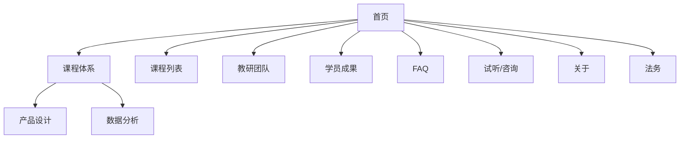

# Information Architecture — 启航学堂官网

- 生成 Skill: web-information-architecture
- 日期: 2026-11-03
- 输入: `01-design-brief.md` + `00-project-intake.md`
- 置信度: medium（价格页与学员入口未定）

## 1. 信息架构目标

围绕「理解教什么 → 建立信任 → 申请试听/咨询」组织内容；移动优先导航；避免按公司部门拆站。[FACT 目标源自 Brief]

## 2. 内容盘点

| 内容类型 | 来源 | 状态 |
|---|---|---|
| 品牌简述 | 口述 | 需撰写 |
| 产品线：产品设计 / 数据分析 | 口述 | 需结构化 |
| 课程列表摘要 | 口述 | 档位价格未定 |
| 教研团队 | 口述 | 需素材 |
| FAQ | 待建 | 内容缺口 |
| 咨询/试听表单 | 需求明确 | 字段待确认 |
| 法务页 | 需求明确 | 文案 TODO |
| 学员成果 | 有图但授权不全 | 条件展示 |
| 学习入口 | 未定 | 暂不进主导航 |

## 3. 用户任务

| 优先级 | 任务 | 完成定义 |
|---|---|---|
| P0 | 理解教什么与是否适合我 | 到达产品线或课程摘要并读完定位段落 |
| P0 | 申请试听或咨询 | 表单提交成功 |
| P1 | 建立对教研的信任 | 浏览团队页关键信息 |
| P1 | 解决顾虑 | FAQ 命中问题 |
| P2 | 找上课入口 | 待确认后补入口 |

## 4. 内容分类（用户任务视角）

1. **了解**：首页、关于启航  
2. **选择**：产品线、课程  
3. **信任**：团队、（条件）学员成果、FAQ  
4. **行动**：试听/咨询  
5. **合规**：隐私、协议  

不按「运营部 / 教研部」分导航。[INFER]

## 5. 网站 Sitemap

```text
首页 /
├── 课程体系 /programs
│   ├── 产品设计 /programs/product-design
│   └── 数据分析 /programs/data-analytics
├── 课程列表 /courses
├── 教研团队 /team
├── 学员成果 /stories          [条件：授权确认后发布]
├── 常见问题 /faq
├── 申请试听/咨询 /apply
├── 关于启航 /about
├── 隐私政策 /legal/privacy
└── 用户协议 /legal/terms
```

Mermaid：



**未纳入首期**：价格独立页（改在课程卡「咨询了解」或授权后加 `/pricing`）。[FACT + TODO]

## 6. 页面层级

- L1：首页、课程体系、课程列表、团队、FAQ、申请、关于  
- L2：产品设计、数据分析、法务子页、学员成果（条件）  
- L3：暂不强制（单课详情可二期）

## 7. 导航结构

**Primary（桌面）**：课程体系 · 课程 · 团队 · FAQ · 申请试听  

**Primary（移动）**：同项收入汉堡/底部主 CTA「申请试听」常驻。[INFER]

**Secondary**：关于启航  

**Footer**：产品线链接、FAQ、申请、关于、隐私、协议；（可选）第三方上课入口文案链  

**Contextual**：课程卡 → 对应产品线；产品线页 → 申请；FAQ 答末 CTA → 申请  

**Breadcrumb**：L2 产品线页启用。

## 8. 页面关系

| 从 | 到 | 关系 |
|---|---|---|
| 首页 | 课程体系 / 申请 | 主入口 |
| 课程体系 | 产品线 L2 | 向下钻取 |
| 课程列表 | 申请 | 转化 |
| 团队 / FAQ | 申请 | 信任后转化 |
| 任意营销页 | 法务 | Footer |

死路规避：每条产品线页与课程列表均有明确申请出口。

## 9. 核心用户路径

**路径 A（认知→转化）**  
首页 → 课程体系 → 产品设计 → 申请试听/咨询  

**路径 B（目录→转化）**  
首页 → 课程列表 → 申请  

**路径 C（信任→转化）**  
首页 → 团队 → FAQ → 申请  

## 10. 页面优先级

| 页面 | 优先级 |
|---|---|
| 首页、申请、课程体系、课程列表 | P0 |
| 团队、FAQ、关于、法务 | P0/P1 |
| 学员成果 | P1 条件发布 |
| 单课详情、价格页、学习中心入口 | P2 / 待确认 |

## 11. 设计依据

- Brief：2 分钟说清教什么；主转化表单；不做 LMS。[FACT]  
- 分类按任务而非部门。[方法论]  
- 价格未定 → 不强迫价格页进 Sitemap。[FACT]

## 12. 风险与待确认事项

1. 申请页文案：试听 vs 咨询合并？[TODO]  
2. 学员成果是否进主导航（授权前建议仅 Footer 或隐藏）。[TODO]  
3. 已购上课入口是否进入 Footer。[TODO]  
4. 课程列表粒度：摘要卡 vs 未来单课页。[TODO]

## 可用性自检（摘要）

- [x] 无重复「首页式」多入口页  
- [x] P0 任务有路径  
- [x] 移动主 CTA 已考虑  
- [x] 内容缺口（FAQ/法务）已标出  
- [ ] 价格策略确认前 Sitemap 保持可扩展 `/pricing`
